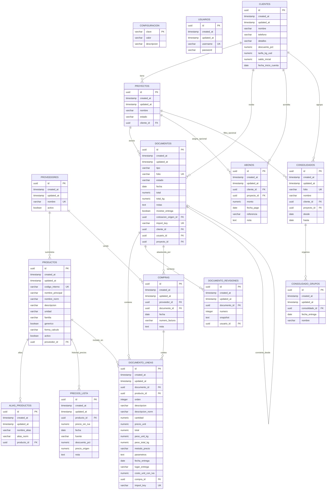

# Modelo de Datos (Esquema Lógico) — BillMe

> **Nota:** Todas las tablas de entidades de negocio (excepto `configuracion` que maneja llave por clave) incluyen `id UUID PRIMARY KEY`, `created_at TIMESTAMP WITH TIME ZONE` y `updated_at TIMESTAMP WITH TIME ZONE`.

---

## 1. Diagrama Entidad-Relación

---

## 2. Diccionario de Tablas

### 2.1. Seguridad y Parámetros

#### Tabla: `usuarios`
| Campo | Tipo | Nulo | Descripción |
|---|---|---|---|
| `id` | UUID | NO | Llave primaria. |
| `created_at` | TIMESTAMPTZ | NO | Fecha de creación. |
| `updated_at` | TIMESTAMPTZ | NO | Fecha de actualización. |
| `username` | VARCHAR(50) | NO | Nombre de usuario único para autenticación. |
| `password` | VARCHAR(100) | NO | Contraseña con hash seguro BCrypt. |

#### Tabla: `configuracion`
| Campo | Tipo | Nulo | Descripción |
|---|---|---|---|
| `clave` | VARCHAR(50) | NO | Llave primaria (ej. `iva_pct`, `tipo_cambio`, `tarifa_kg_usd`, `densidad_kg_in3`, `dias_precio_viejo`). |
| `valor` | VARCHAR(100) | NO | Valor parametrizado. |
| `descripcion` | VARCHAR(200) | NO | Descripción explicativa del parámetro de negocio. |

---

### 2.2. Directorio y Proyectos

#### Tabla: `clientes`
| Campo | Tipo | Nulo | Descripción |
|---|---|---|---|
| `id` | UUID | NO | Llave primaria. |
| `created_at` | TIMESTAMPTZ | NO | Fecha de creación. |
| `updated_at` | TIMESTAMPTZ | NO | Fecha de actualización. |
| `nombre` | VARCHAR(100) | NO | Nombre comercial o personal del cliente. |
| `telefono` | VARCHAR(50) | SÍ | Teléfono o número de WhatsApp. |
| `detalles` | TEXT | SÍ | Notas y condiciones particulares. |
| `descuento_pct` | NUMERIC(5, 2) | NO | Descuento porcentual otorgado por defecto sobre lista. |
| `tarifa_kg_usd` | NUMERIC(8, 4) | SÍ | Tarifa en USD/kg para cálculo de placas y platinas. |
| `saldo_inicial` | NUMERIC(14, 2) | NO | Saldo deudor anterior a la fecha de inicio de cuenta. |
| `fecha_inicio_cuenta`| DATE | SÍ | Fecha a partir de la cual las facturas y abonos computan deuda. |

#### Tabla: `proyectos`
| Campo | Tipo | Nulo | Descripción |
|---|---|---|---|
| `id` | UUID | NO | Llave primaria. |
| `created_at` | TIMESTAMPTZ | NO | Fecha de creación. |
| `updated_at` | TIMESTAMPTZ | NO | Fecha de actualización. |
| `cliente_id` | UUID | NO | Llave foránea hacia `clientes`. |
| `nombre` | VARCHAR(100) | NO | Nombre del proyecto u obra. |
| `estado` | VARCHAR(20) | NO | Estado del proyecto (`ACTIVO` o `FINALIZADO`). |

---

### 2.3. Catálogo y Proveedores

#### Tabla: `proveedores`
| Campo | Tipo | Nulo | Descripción |
|---|---|---|---|
| `id` | UUID | NO | Llave primaria. |
| `created_at` | TIMESTAMPTZ | NO | Fecha de creación. |
| `updated_at` | TIMESTAMPTZ | NO | Fecha de actualización. |
| `nombre` | VARCHAR(100) | NO | Nombre comercial del proveedor. |
| `activo` | BOOLEAN | NO | Indica si el proveedor está habilitado. |

#### Tabla: `productos`
| Campo | Tipo | Nulo | Descripción |
|---|---|---|---|
| `id` | UUID | NO | Llave primaria. |
| `created_at` | TIMESTAMPTZ | NO | Fecha de creación. |
| `updated_at` | TIMESTAMPTZ | NO | Fecha de actualización. |
| `proveedor_id` | UUID | SÍ | Llave foránea hacia `proveedores`. |
| `codigo_interno` | VARCHAR(50) | NO | Código de catálogo único. |
| `nombre_principal`| VARCHAR(200) | NO | Nombre legible del producto. |
| `nombre_norm` | VARCHAR(200) | NO | Nombre normalizado en minúsculas para búsqueda por trigramas. |
| `descripcion` | TEXT | SÍ | Descripción técnica adicional. |
| `unidad` | VARCHAR(20) | NO | Unidad de medida (`UND`, `M`, `KG`, etc.). |
| `familia` | VARCHAR(20) | SÍ | Categoría del material (ej. `LAMINAS`, `TUBOS`, `PERLINES`). |
| `generico` | BOOLEAN | NO | `true` si es producto de plantilla libre o a medida. |
| `forma_calculo` | VARCHAR(20) | NO | Algoritmo geométrico: `NINGUNA`, `PLACA`, `PLATINA`, `ANGULAR`. |
| `activo` | BOOLEAN | NO | Indica si está disponible en catálogo. |

#### Tabla: `alias_productos`
| Campo | Tipo | Nulo | Descripción |
|---|---|---|---|
| `id` | UUID | NO | Llave primaria. |
| `producto_id` | UUID | NO | Llave foránea hacia `productos`. |
| `nombre_alias` | VARCHAR(200) | NO | Nombre alternativo de búsqueda. |
| `alias_norm` | VARCHAR(200) | NO | Alias normalizado para índice trigrama. |

#### Tabla: `precios_lista`
| Campo | Tipo | Nulo | Descripción |
|---|---|---|---|
| `id` | UUID | NO | Llave primaria. |
| `producto_id` | UUID | NO | Llave foránea hacia `productos`. |
| `precio_sin_iva` | NUMERIC(12, 4)| NO | Precio de lista base del proveedor sin IVA. |
| `fecha` | DATE | NO | Fecha a partir de la cual rige el precio. |
| `fuente` | VARCHAR(30) | NO | Origen: `LISTA_IMPORTADA`, `FACTURA_PROVEEDOR`, `PRECIO_CLIENTE`, `MANUAL`. |
| `descuento_pct` | NUMERIC(5, 2) | SÍ | Descuento registrado en el origen. |
| `precio_origen` | NUMERIC(12, 4)| SÍ | Precio bruto del que se dedujo la lista. |
| `nota` | TEXT | SÍ | Observaciones sobre el registro de precio. |

---

### 2.4. Documentos Comerciales

#### Tabla: `documentos`
| Campo | Tipo | Nulo | Descripción |
|---|---|---|---|
| `id` | UUID | NO | Llave primaria. |
| `tipo` | VARCHAR(20) | NO | Tipo: `COTIZACION` o `FACTURA`. |
| `folio` | VARCHAR(50) | NO | Folio único con prefijo (`COT-XXXX` o `FAC-XXXX`). |
| `estado` | VARCHAR(20) | NO | `PENDIENTE`, `ACEPTADA`, `RECHAZADA`, `ACTIVA`, `ANULADA`. |
| `fecha` | DATE | NO | Fecha formal del documento. |
| `cliente_id` | UUID | NO | Llave foránea hacia `clientes`. |
| `proyecto_id` | UUID | SÍ | Llave foránea hacia `proyectos`. |
| `usuario_id` | UUID | NO | Llave foránea hacia `usuarios`. |
| `total` | NUMERIC(14, 2)| NO | Monto total con IVA incluido en Córdobas (C$). |
| `total_kg` | NUMERIC(12, 2)| NO | Suma total del peso de las líneas en kilogramos. |
| `notas` | TEXT | SÍ | Observaciones internas (no se imprimen al exportar). |
| `mostrar_entrega`| BOOLEAN | NO | Activa control de fechas y lugares de entrega en líneas. |
| `cotizacion_origen_id` | UUID | SÍ | Llave foránea hacia `documentos` cuando se convierte de cotización. |
| `import_key` | VARCHAR(64) | SÍ | Clave hash para conciliación e importación idempotente. |

#### Tabla: `documento_lineas`
| Campo | Tipo | Nulo | Descripción |
|---|---|---|---|
| `id` | UUID | NO | Llave primaria. |
| `documento_id` | UUID | NO | Llave foránea hacia `documentos`. |
| `producto_id` | UUID | NO | Llave foránea hacia `productos`. |
| `orden` | INTEGER | NO | Posición secuencial de la línea. |
| `descripcion` | VARCHAR(500) | NO | Descripción textual impresa del material o servicio. |
| `descripcion_norm`| VARCHAR(500)| NO | Descripción normalizada para búsquedas. |
| `cantidad` | NUMERIC(12, 2)| NO | Cantidad de unidades vendidas. |
| `precio_unit` | NUMERIC(12, 2)| NO | Precio unitario con IVA en Córdobas (C$). |
| `total` | NUMERIC(14, 2)| NO | Total de línea redondeado a 2 decimales (`r2(cantidad * precio_unit)`). |
| `peso_unit_kg` | NUMERIC(10, 2)| SÍ | Peso estimado por unidad en kg. |
| `peso_total_kg` | NUMERIC(12, 2)| SÍ | Peso total de la línea (`cantidad * peso_unit_kg`). |
| `metodo_precio` | VARCHAR(20) | NO | `ULTIMO_PRECIO`, `FORMULA_LISTA`, `POR_PESO`, `POR_METRO`, `MANUAL`. |
| `parametros` | TEXT | SÍ | JSON con cotas y variables utilizadas en el cálculo de la línea. |
| `fecha_entrega` | DATE | SÍ | Fecha de despacho o entrega en obra. |
| `lugar_entrega` | VARCHAR(200) | SÍ | Destino físico o sitio de entrega. |
| `costo_unit_con_iva` | NUMERIC(12, 2)| SÍ | Costo real unitario asignado por compra de proveedor. |
| `compra_id` | UUID | SÍ | Llave foránea hacia `compras`. |
| `import_key` | VARCHAR(64) | SÍ | Clave hash de importación. |

#### Tabla: `documento_revisiones`
| Campo | Tipo | Nulo | Descripción |
|---|---|---|---|
| `id` | UUID | NO | Llave primaria. |
| `documento_id` | UUID | NO | Llave foránea hacia `documentos`. |
| `numero` | INTEGER | NO | Número consecutivo de revisión. |
| `snapshot` | TEXT | NO | JSON completo inmutable con los datos del documento al ser editado. |
| `usuario_id` | UUID | SÍ | Llave foránea hacia `usuarios` que realizó la modificación. |

---

### 2.5. Cuenta Corriente y Abonos

#### Tabla: `abonos`
| Campo | Tipo | Nulo | Descripción |
|---|---|---|---|
| `id` | UUID | NO | Llave primaria. |
| `cliente_id` | UUID | NO | Llave foránea hacia `clientes`. |
| `proyecto_id` | UUID | SÍ | Llave foránea hacia `proyectos` (opcional). |
| `monto` | NUMERIC(14, 2)| NO | Monto acreditado a la cuenta en Córdobas (C$). |
| `fecha_pago` | DATE | NO | Fecha efectiva del pago. |
| `referencia` | VARCHAR(100) | SÍ | Referencia bancaria, cheque o número de transferencia. |
| `nota` | TEXT | SÍ | Observaciones del abono. |

---

### 2.6. Consolidados de Cobro

#### Tabla: `consolidados`
| Campo | Tipo | Nulo | Descripción |
|---|---|---|---|
| `id` | UUID | NO | Llave primaria. |
| `folio` | VARCHAR(50) | NO | Folio único con prefijo `CONS-XXXX`. |
| `nombre` | VARCHAR(200) | NO | Título o descripción del estado consolidado. |
| `cliente_id` | UUID | NO | Llave foránea hacia `clientes`. |
| `proyecto_id` | UUID | SÍ | Llave foránea hacia `proyectos` (opcional). |
| `desde` | DATE | NO | Fecha inicial del rango. |
| `hasta` | DATE | NO | Fecha final del rango. |

#### Tabla: `consolidado_grupos`
| Campo | Tipo | Nulo | Descripción |
|---|---|---|---|
| `id` | UUID | NO | Llave primaria. |
| `consolidado_id`| UUID | NO | Llave foránea hacia `consolidados`. |
| `fecha_entrega` | DATE | NO | Fecha de entrega correspondiente a la agrupación. |
| `nombre` | VARCHAR(200) | NO | Nombre personalizado del subtotal o bloque. |

---

### 2.7. Abastecimiento y Compras

#### Tabla: `compras`
| Campo | Tipo | Nulo | Descripción |
|---|---|---|---|
| `id` | UUID | NO | Llave primaria. |
| `proveedor_id` | UUID | NO | Llave foránea hacia `proveedores`. |
| `documento_id` | UUID | NO | Llave foránea hacia `documentos` (factura ligada). |
| `fecha` | DATE | NO | Fecha de la factura del proveedor. |
| `numero_factura`| VARCHAR(50) | SÍ | Número de factura o remisión del proveedor. |
| `nota` | TEXT | SÍ | Observaciones de la compra. |
